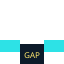

# Tharun Infinity Runner

<p align="center">
  
</p>

**Tharun Infinity Runner** (menu title: **THARUN RUNNER**) is a neon arcade endless runner. You auto-sprint through a scrolling world, jump over hazards, collect pickups, and chase a higher score while difficulty ramps up over distance.

Built with **TypeScript**, **Phaser 3**, and **Vite**. The project follows a modular architecture (config → managers → entities → scenes) and completed **20 development milestones** documented in [`DEVELOPMENT_PLAN.md`](DEVELOPMENT_PLAN.md).

---

## Table of contents

- [Prerequisites](#prerequisites)
- [Install and run](#install-and-run)
- [Build for production](#build-for-production)
- [How to play](#how-to-play)
- [Game content at a glance](#game-content-at-a-glance)
- [Obstacles (4 types)](#obstacles-4-types)
- [Collectibles (8 types)](#collectibles-8-types)
- [Power-ups (5 types)](#power-ups-5-types)
- [Scoring and difficulty](#scoring-and-difficulty)
- [Unlocks (4 runner skins)](#unlocks-4-runner-skins)
- [Menus and persistence](#menus-and-persistence)
- [Controls reference](#controls-reference)
- [Project structure](#project-structure)
- [What we built (milestones)](#what-we-built-milestones)
- [Quality and testing](#quality-and-testing)
- [Optional assets](#optional-assets)
- [License and repo](#license-and-repo)

---

## Prerequisites

| Requirement | Notes |
|-------------|--------|
| **Node.js** | 18+ recommended (22 LTS works well) |
| **npm** | Ships with Node.js |
| **Modern browser** | Chrome, Edge, or Firefox for desktop; mobile works in **landscape** |
| **Git** | To clone this repository |

No database or backend is required — the game runs entirely in the browser. Progress is saved to **localStorage**.

---

## Install and run

Clone the repo, install dependencies, and start the dev server:

```bash
git clone https://github.com/sri-tharun-indugula/C-Users-sindu-AppData-Local-Temp-e6a32dc7-5bee-4452-b064-c247b05d81a0.git
cd C-Users-sindu-AppData-Local-Temp-e6a32dc7-5bee-4452-b064-c247b05d81a0
npm install
npm run dev
```

Open **http://localhost:8080/** (Vite is configured for port **8080** in [`vite.config.ts`](vite.config.ts)).

On Windows, if `npm` is blocked by execution policy, use:

```powershell
npm.cmd install
npm.cmd run dev
```

### npm scripts

| Command | Description |
|---------|-------------|
| `npm run dev` | Development server with hot reload |
| `npm run build` | TypeScript check + production bundle to `dist/` |
| `npm run preview` | Serve the production build locally |
| `npm run lint` | ESLint on `src/**/*.ts` |
| `npm run format` | Prettier format for `src` and `index.html` |

---

## Build for production

```bash
npm run build
npm run preview
```

Deploy the contents of `dist/` to any static host (GitHub Pages, Netlify, Vercel static, etc.). The Vite `base` is set to `./` for relative asset paths.

---

## How to play

1. **Main menu** — You see **THARUN RUNNER**, your best score, and total banked coins.
2. Tap **Start** — Opens the in-game **How to Play** guide with **animated sprites** (same art as gameplay).
3. **Begin run** — From the guide, start the run. Your runner moves forward automatically.
4. **Jump** — Clear ground blocks and pits. You have a **double jump** (2 jumps before landing).
5. **Collect** — Coins, gems, and orbs add score; power-up pickups activate timed effects (see below).
6. **Survive** — Avoid spikes, crates, hover blocks, and pits. **Shield** blocks one obstacle hit but **does not** save you from pits.
7. **Extra lives** — **1-Up** pickups add a stored life; on death, a life revives you once.
8. **Pause** — `P`, `Esc`, or the on-screen Pause button. Resume, open Settings, or return to Menu.
9. **Game Over** — Restart, view High Scores, or go back to Menu. Best score and coins persist in the browser.

**Tips** (also shown in-game):

- Land smoothly — hard falls can throw off your rhythm.
- Watch HUD timers when power-ups are active.
- Speed Boost and Slow-Mo cancel each other if you pick up both.

---

## Game content at a glance

| Category | Count | Details |
|----------|------:|---------|
| **Obstacle types** | **4** | Spike, Rock, Moving (hover), Pit |
| **Collectible types** | **8** | Coin, Gem, Score Orb, + 5 power-up pickups |
| **Power-up effects** | **5** | Shield, Magnet, Speed, Slow-Mo, 1-Up |
| **Score pickups** | **3** | Coin, Gem, Score Orb |
| **Runner skins (unlocks)** | **4** | Cyan (default), Magenta, Gold, Lime |
| **High score slots** | **5** | Top runs stored locally |
| **Player jumps** | **2** | Ground jump + one mid-air jump |
| **Difficulty display levels** | **1–10** | HUD level from distance ramp |

---

## Obstacles (4 types)

| Icon | Name | What to do |
|:----:|------|------------|
|  | **Spike Block** | Toothed ground block — jump over it |
|  | **Crate Block** | Solid cube on the ground — clear with a jump |
|  | **Hover Block** | Floats vertically — time your jump |
|  | **Pit** | Gap in the track — jump the gap (shield does **not** help) |

Obstacles spawn procedurally ahead of the player with weighted randomness; pits grow wider and moving hazards faster as difficulty increases.

---

## Collectibles (8 types)

### Score pickups (3)

| Icon | Name | Effect |
|:----:|------|--------|
|  | **Coin** | **+10** score, **+1** banked coin |
|  | **Gem** | **+50** score, **+5** banked coins |
|  | **Score Orb** | **+100** score |

### Power-up pickups (5)

These items activate the power-up system when collected (same five effects as below).

| Icon | Pickup | Activates |
|:----:|--------|-----------|
|  | Shield pickup | Shield effect |
|  | Magnet pickup | Magnet effect |
|  | Speed pickup | Speed Boost |
|  | Slow-Mo pickup | Slow Motion |
|  | 1-Up pickup | Extra life |

Collectibles can spawn at **low**, **mid**, or **high** heights and use animated sprite sheets in-game.

---

## Power-ups (5 types)

| Icon | Power-up | Effect | Active duration | Cooldown after use |
|:----:|----------|--------|-----------------|-------------------|
|  | **Shield** | Absorbs **one** obstacle hit | 6 s | 8 s |
|  | **Magnet** | Pulls nearby coins/pickups toward you (300px radius) | 5.5 s | 7 s |
|  | **Speed Boost** | Scroll speed × **1.45** | 4.5 s | 9 s |
|  | **Slow-Mo** | Scroll speed × **0.55** | 4.5 s | 9 s |
|  | **1-Up** | **+1** extra life (revive on death) | Instant (no timer) | 12 s |

Configuration lives in [`src/config/PowerUpConfig.ts`](src/config/PowerUpConfig.ts) and [`src/config/CollectibleConfig.ts`](src/config/CollectibleConfig.ts).

---

## Scoring and difficulty

**Score** combines:

- **Distance** — 1 point per meter traveled
- **Pickup points** — coins, gems, and score orbs (values above)
- **Best score** — tracked across runs; up to **5** entries on the High Scores board

**Difficulty** ramps with distance (see [`src/config/DifficultyConfig.ts`](src/config/DifficultyConfig.ts)):

- Scroll speed increases (up to ~**1.55×** base speed)
- Obstacles spawn more often
- More moving blocks and pits over time
- HUD shows **Level 1–10** based on progress

---

## Unlocks (4 runner skins)

Earned through the **Unlocks** menu; equipped skins change your runner tint in-game.

| Skin | How to unlock |
|------|----------------|
| **Cyan Runner** | Default |
| **Magenta Rush** | Bank **50** total coins |
| **Gold Rush** | Bank **200** total coins |
| **Toxic Speed** | Best score **800+** |

Definitions: [`src/config/SaveConfig.ts`](src/config/SaveConfig.ts).

---

## Menus and persistence

| Menu item | Purpose |
|-----------|---------|
| **Start** | How to Play guide → begin run |
| **High Scores** | Top 5 runs (score, distance, coins) |
| **Unlocks** | View and equip runner skins |
| **Settings** | Mute, master volume, FPS overlay |

Saved locally under unified save key `infinite-runner:save-v1` (profile + settings). Legacy score/audio keys are migrated automatically.

---

## Controls reference

| Action | Desktop | Mobile / touch |
|--------|---------|----------------|
| **Jump** | `Space`, `↑`, click on canvas | **JUMP** button |
| **Double jump** | Jump again in mid-air | Same |
| **Pause** | `P`, `Esc` | **Pause** button |
| **FPS monitor** | `F` or Settings → Show FPS | Settings |

Portrait mode shows a **rotate device** prompt; play in **landscape** for the best layout.

---

## Project structure

```
src/
  config/       # Game tuning (obstacles, collectibles, power-ups, difficulty, saves)
  core/         # Phaser Game bootstrap and base scene
  scenes/       # Boot, Preload, MainMenu, Game
  entities/     # Player, ground, obstacles, collectibles
  managers/     # Spawning, collision, audio, score, save, power-ups, particles, etc.
  ui/           # DOM overlay (menus, HUD, touch controls, how-to-play previews)
  utils/        # Pools, textures, local storage helpers
public/
  assets/       # Optional image/audio files (see below)
docs/
  readme/       # SVG icons used in this README
```

Path alias `@/` → `src/` (see `tsconfig.json` and `vite.config.ts`).

---

## What we built (milestones)

All **20 milestones** in [`DEVELOPMENT_PLAN.md`](DEVELOPMENT_PLAN.md) are marked **Done**:

1. Project setup (Vite, TypeScript, ESLint, Prettier, scenes)  
2. Camera and parallax world  
3. Player (run / jump / fall / land animations, double jump)  
4. Physics  
5. Procedural ground  
6. Obstacles (4 types)  
7. Collision system  
8. Coins and collectibles (8 types)  
9. Score system  
10. Difficulty scaling  
11. Audio (BGM + SFX)  
12. UI (menus, HUD, DOM overlay)  
13. Power-ups (5 types)  
14. Particle effects  
15. Animations  
16. Mobile support (touch, orientation guard)  
17. Performance optimization  
18. Save system and unlocks  
19. Polish  
20. Final testing checklist ([`TESTING.md`](TESTING.md))

**Tech stack:** TypeScript, Phaser 3.90, Vite 6, HTML5 Canvas, ESLint, Prettier.

---

## Quality and testing

Before release, walk through [`TESTING.md`](TESTING.md): desktop and mobile controls, power-ups, pits vs shield, pause, persistence, unlocks, audio, collisions, and ~60 FPS performance.

Debug: the running game exposes `window.__PHASER_GAME__` for smoke tests.

---

## Optional assets

The game generates most sprites at runtime (player, collectibles, procedural backgrounds). You can still add files under `public/assets/`:

| Path | Purpose |
|------|---------|
| `public/assets/images/*.png` | Logo, backgrounds, ground tiles, obstacle art (see [`AssetManager`](src/managers/AssetManager.ts)) |
| `public/assets/audio/*.mp3` | BGM, jump, collect SFX |

Missing files fall back to generated placeholder textures where implemented.

For **pixel-perfect** previews of obstacles and pickups, use the in-game **How to Play** screen — it renders icons from the same Phaser textures via [`GuidePreviewFactory`](src/ui/GuidePreviewFactory.ts).

---

## License and repo

- **Package name:** `tharun-infinity-runner` (v0.1.0)  
- **Remote:** `origin` → GitHub (`sri-tharun-indugula/...`)

---

<p align="center"><strong>Jump farther. Run longer.</strong></p>
